# EquiFusion - Kinematics-Agnostic Human Motion Prediction via Equivariant Latent Diffusion (ECCV 2026)
**[Website](https://ceveloper.github.io/publications/equifusion/)** |
**[Paper](https://arxiv.org/abs/2607.10984)** |
**Demo** (coming soon) |
**[Models](https://huggingface.co/EquiFusion)**

This is the official repository for the ECCV 2026 paper
"_EquiFusion: Kinematics-Agnostic Human Motion Prediction via Equivariant Latent Diffusion_".

Authors:
[Cecilia Curreli](https://ceveloper.github.io/),
[Florian Hofherr](https://florianhofherr.github.io/),
[Dominik Muhle](https://dominikmuhle.github.io/),
[Abhishek Saroha](https://cvg.cit.tum.de/members/saroha),
[Riccardo Marin](https://ricma.netlify.app/),
[Daniel Cremers](https://cvg.cit.tum.de/members/cremers)

<p align="center">
  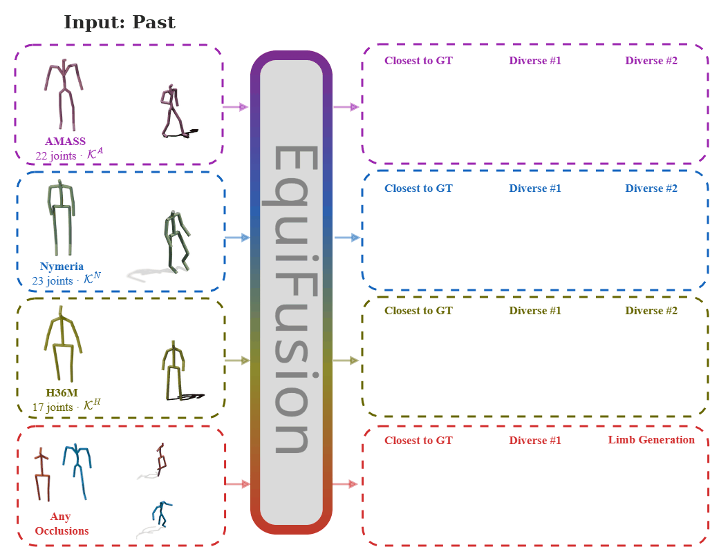
</p>

### Examples
The same model (`cross_kinematics/amass_nymeria`, which will be released in a few days) on different skeletons: the prediction closest to the ground truth, then diverse predictions.

| | Closest to GT | Diverse 1 | Diverse 2 |
|---|---|---|---|
| AMASS | 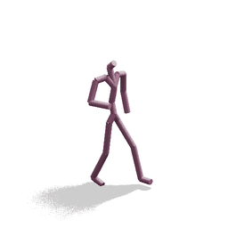 | 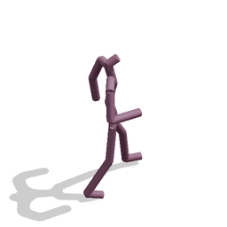 |  |
| Nymeria | 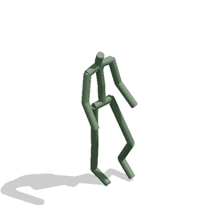 |  |  |
| H36M zero-shot kinematics (unseen skeleton) | 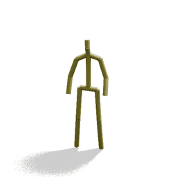 | 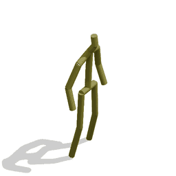 |  |
| H36M, zero-shot kinematics (missing limbs) | 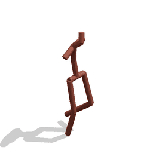 |  |  |

| | | | |
|---|---|---|---|
| MoYoga, out-of-distribution motions (AMASS kinematics)| 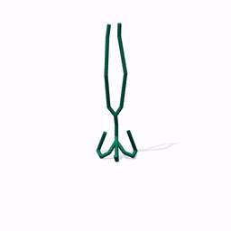 | 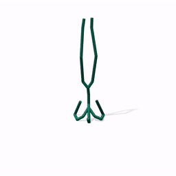 | 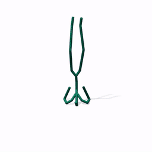 |

| | | |
|---|---|---|
| AMASS, zero-shot kinematics (missing limbs) | 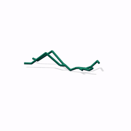<br>One arm missing | 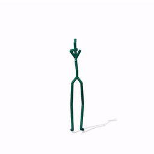<br>Both arms missing |

## Intro

We address **kinematics-agnostic** (skeleton-agnostic) **stochastic 3D human motion prediction**: given a past motion, predict plausible futures for *any* skeleton, without hard-coding its kinematics. EquiFusion is a **permutation equivariant latent diffusion** model that treats the skeleton's kinematic connectivity as an explicit input, so its internal computations are agnostic to joint ordering and graph structure.

Instead of trying to unify different skeleton types or kinematics, we address the problem from a different angle: how to support **any** kinematics, which already exist or will be created in the future?

This design enables for the first time **cross-dataset / cross-skeleton generalization** and new **zero-shot** tasks: testing on kinematics unseen at training such as **zero-shot kinematics**, motion prediction from partial or **occluded observations** and targeted **limb generation** via heuristics. EquiFusion presents a single trained instance for all datasets - while remaining up to **75% more compact** than kinematics specific baselines, with faster training and inference.


### Index
- [EquiFusion: Equivariant Latent Diffusion](#equifusion-equivariant-latent-diffusion)
- [Demo](#demo)
- [Installation](#installation)
- [Released models](#released-models)
- [Datasets](#datasets)
- [Inference](#inference)
- [Evaluation](#evaluation)
- [Training](#training)
- [Verifying the Property of Permutation Equivariance](#verifying-the-property-of-permutation-equivariance)
- [Zero-Shot Inference and Zero-Shot Kinematics](#zero-shot-inference-and-zero-shot-kinematics-evaluating-on-a-new-skeleton-or-dataset)
- [Differences from SkeletonDiffusion](#differences-from-skeletondiffusion)

## EquiFusion: Equivariant Latent Diffusion

<p align="center">
  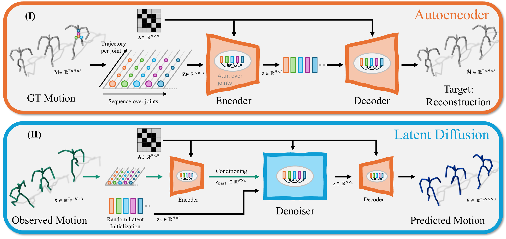
</p>

EquiFusion is a latent diffusion model that is fully equivariant. Additionally, it takes as input the adjacency matrix i.e. kinematic tree of the skeleton graph. EquiFusion consists of an autoencoder and a latent diffusion model.

The **equivariant autoencoder** is a graph transformer whose nodes are the bones or joints of the skeleton, connected according to the input kinematic tree. It encodes a motion into one latent per joint or graph node.  
The **equivariant denoiser** also consists of graph attention and self attention layers. It generates the latents of the future motions with a diffusion process of 10 steps, conditioned on the latents of the observed motion. The decoder maps the latents back to motion space. All layers are permutation equivariant and share their weights across nodes, so the same model runs on skeletons with different
numbers of joints and connectivity. 

We proposed a new representation of the human motion i.e. human pose, which we call **bone directions** representation: the model predicts the direction of each bone, and the bone lengths
of the observed skeleton are kept by construction.

## Demo

A live demo on Hugging Face Spaces will be released in a few days, together with the models trained on Nymeria.

## Installation

```bash
git clone https://github.com/Ceveloper/EquiFusion.git && cd EquiFusion
conda env create -f environment.yml
conda activate equifusion
```
The environment pins the versions used to train and evaluate the released models (Python 3.13, PyTorch 2.6, CUDA 12.6).

## Released models

All models are released on Hugging Face in the [EquiFusion organization](https://huggingface.co/EquiFusion) and can be downloaded in Python:
```python
from src.inference_utils import download_equifusion
checkpoint = download_equifusion("EquiFusion/equifusion-cross-kinematics-amass")
```
or placed manually in `./trained_models/<name>/`. Each model folder contains the latent diffusion model (`config.yaml`,
`checkpoints/checkpoint_375.safetensors`) and its autoencoder (`autoencoder/`).

| Name | Hugging Face | Training data | Representation | Use |
|---|---|---|---|---|
| `cross_kinematics/amass_nymeria` | coming soon | AMASS + Nymeria | bone directions | main model; zero-shot on other skeletons (H36M, MoYo) |
| `cross_kinematics/amass_nymeria_h36m` | coming soon | AMASS + Nymeria + H36M | bone directions | trained on three datasets |
| `cross_kinematics/amass` | [`EquiFusion/equifusion-cross-kinematics-amass`](https://huggingface.co/EquiFusion/equifusion-cross-kinematics-amass) | AMASS | bone directions | zero-shot on unseen skeletons (cross-topology) |
| `cross_kinematics/amass_nymeria_3d` | coming soon | AMASS + Nymeria | 3D joints ("Ours (M)") | main model, arbitrary missing joints |
| `in_domain/amass` | [`EquiFusion/equifusion-in-domain-amass`](https://huggingface.co/EquiFusion/equifusion-in-domain-amass) | AMASS | bone directions | same-dataset evaluation |
| `in_domain/nymeria` | coming soon | Nymeria | bone directions | same-dataset evaluation |
| `in_domain/h36m` | [`EquiFusion/equifusion-in-domain-h36m`](https://huggingface.co/EquiFusion/equifusion-in-domain-h36m) | H36M | bone directions | same-dataset evaluation |

## Datasets

The main EquiFusion model is trained on **AMASS** and **Nymeria**, and is evaluated also zero-shot on **Human3.6M (H36M)** and **MoYo**. As shown in the table above, we also provide code and trained weights for other versions of EquiFusion, trained for example on single-dataset as conventional SHMP approaches (e.g. AMASS only), or with a different motion parametrization (3D joints vs our bone directions).
You only need the datasets you want to train or evaluate on.

The small annotation files (test/validation segments, multimodal-APD ground truth, CMD reference values) are part of this repository in `datasets/annotations/`
(the AMASS and H36M segments are the same as in [SkeletonDiffusion](https://github.com/Ceveloper/SkeletonDiffusion)).
Download the raw data from the original sources (their licenses apply) to `datasets/raw/`; the scripts in `src/data/` convert it to `datasets/processed/`,
which is what training and evaluation read.

```
datasets
├── annotations      # in the repository
│   ├── AMASS/hmp/        segments_test.csv, mmapd_GT.csv, mean_motion_test.txt
│   ├── Human36M/hmp/     segments_test.csv, segments_valid.csv, mmapd_GT.csv, mean_motion_test.txt
│   └── MOYO/hmp/         segments_test_zero_shot.csv, mean_motion_test.txt
├── raw              # downloaded by you
└── processed        # created by the scripts below
```

All scripts are run from the repository root: `python -m src.data.create_<dataset>_dataset [--gpu]`
(`--gpu` only speeds up the body-model forward pass of AMASS and MoYo).

Normalization statistics (`processed/<Dataset>/hmp/statistics/`) are computed automatically the first time a dataset is processed.

### [AMASS](https://amass.is.tue.mpg.de/)

We follow the pipeline of [BeLFusion](https://github.com/BarqueroGerman/BeLFusion) (as SkeletonDiffusion).
1. Download the *SMPL+H G* archives of the 22 datasets ACCAD, BMLhandball, BMLmovi, BMLrub, CMU, DanceDB, DFaust, EKUT, EyesJapanDataset, GRAB, HDM05, HUMAN4D,
   HumanEva, KIT, MoSh, PosePrior, SFU, SOMA, SSM, TCDHands, TotalCapture, Transitions. Put the `.tar.bz2` files, named as in this list
   (e.g. `PosePrior.tar.bz2`), in `datasets/raw/AMASS/` without extracting them.
2. Download the *Extended SMPL+H model* from [MANO](https://mano.is.tue.mpg.de/) and put the `smplh` folder (`male/model.npz`, `female/model.npz`) in `datasets/annotations/AMASS/bodymodels/`.
3. Run
```bash
python -m src.data.create_amass_dataset --gpu --if_extract_zip
```
This extracts the archives (to `datasets/annotations/AMASS/dataset/`, drop `--if_extract_zip` when rerunning) and creates `data_3d_amass.npz` and the multimodal ground truth
`mmgt_test.txt` in `datasets/processed/AMASS/hmp/` (about 1 hour on CPU, 5-15 minutes on GPU).
Split as in BeLFusion: training on ACCAD, BMLhandball, BMLmovi, BMLrub, CMU, EKUT, EyesJapanDataset, KIT, PosePrior, TCDHands, TotalCapture;
validation on HumanEva, HDM05, SFU, MoSh; test on DFaust, DanceDB, GRAB, HUMAN4D, SOMA, SSM, Transitions.

### [Human3.6M](http://vision.imar.ro/human3.6m/description.php)

Download the *Poses -> D3 Positions* of subjects S1, S5, S6, S7, S8, S9, S11 and extract them so that the files are at
`datasets/raw/Human36M/S<i>/MyPoseFeatures/D3_Positions/*.cdf`. Then run
```bash
python -m src.data.create_h36m_dataset
```
which creates `data_3d_h36m.npz` (17 joints) and `mmgt_test.txt` in `datasets/processed/Human36M/hmp/` (about 1 minute on CPU).
Training uses S1, S5, S6, S7, S8, validation S8 and test S9, S11.
H36M is recorded at 50 fps; the models predict 0.5 s -> 2 s at 60 fps, so the H36M windows are resampled to 60 fps (set in the H36M configs).
The FID metric additionally needs the action classifier of [BeLFusion](https://github.com/BarqueroGerman/BeLFusion):
```bash
wget -P datasets/processed/Human36M/hmp https://github.com/BarqueroGerman/BeLFusion/raw/main/auxiliar/h36m_classifier.pth
```

### [Nymeria](https://www.projectaria.com/datasets/nymeria/)

EquiFusion is the first work to use Nymeria for human motion prediction. The Nymeria data pipeline (pre-processing script, splits and test segments) will be released in a few days.

### [MoYo](https://moyo.is.tue.mpg.de/) (zero-shot evaluation)

Download the SMPL+H fits (AMASS format, `*_stageii.npz`) of the `train` and `val` splits to `datasets/raw/MOYO/{train,val}/`.
MoYo has the AMASS skeleton and needs the `smplh` body model of AMASS step 2. Then run
```bash
python -m src.data.create_moyo_dataset --gpu
```
which creates `data_3d_moyo.npz` and `mmgt_test.txt` in `datasets/processed/MOYO/hmp/`. All sequences of both splits are used for testing.

## Inference

See [Inference Example (AMASS model).ipynb](Inference%20Example%20%28AMASS%20model%29.ipynb) (prediction, ranking of the samples, visualization, and the same model applied to a different skeleton)
and [Missing Limbs (AMASS model).ipynb](Missing%20Limbs%20%28AMASS%20model%29.ipynb) (prediction from partial observations and generation of missing limbs).
In short:
```python
from src.inference_utils import load_equifusion, predict
model, skeleton, config = load_equifusion("./trained_models/cross_kinematics/amass/checkpoints/checkpoint_375.safetensors", dataset_name="amass")
pred = predict(model, skeleton, config, obs, num_samples=50)   # obs: [T_obs, J, 3] joint positions in meters
```
`dataset_name` selects the dataset and skeleton (kinematic tree) of the input: the EquiFusion model in the example can be used for `amass`, `h36m` or `moyo`.

## Evaluation

```bash
python eval.py checkpoint_path=./trained_models/cross_kinematics/amass/checkpoints/checkpoint_375.safetensors dataset=amass stats_mode=probabilistic
python eval.py checkpoint_path=./trained_models/cross_kinematics/amass/checkpoints/checkpoint_375.safetensors dataset=h36m stats_mode=probabilistic   # zero-shot on a different skeleton
python eval.py checkpoint_path=./trained_models/cross_kinematics/amass/checkpoints/checkpoint_375.safetensors dataset=moyo stats_mode=probabilistic
```
- `stats_mode=probabilistic` computes all metrics including the multimodal ones (MMADE, MMFDE); `deterministic` is faster.
- Dataset-specific settings are defaults of `configs/config_eval/dataset/*.yaml`: H36M (50 fps) is resampled to the 60-fps windows of the models (0.5 s -> 2 s),
  APDE is computed for AMASS and H36M, FID for H36M.
- Results are written next to the checkpoint (`eval_<dataset>_<batch_size>/...`). `batch_size` (default 512) affects the random samples: keep it fixed when comparing.


## Training

Training has two stages: the equivariant autoencoder, then the equivariant latent diffusion model on the learned equivariant latent space. The datasets, the motion representation
and the permutation probability of the diffusion model are taken from the hydra config of its autoencoder. The commands below reproduce the released models (the commands for the models trained on Nymeria follow with the Nymeria release). Without `output_log_path`, a run is written to
`./output/hmp/<datasets>/{autoencoder,diffusion}/<date>_<time>_<info>/`; the commands set the folder explicitly, so that the diffusion model can refer to its autoencoder.
```bash
# cross_kinematics/amass: AMASS
python train_autoencoder.py 'dataset=[amass]' output_log_path=./output/amass/autoencoder
python train_diffusion.py model.pretrained_autoencoder_path=./output/amass/autoencoder/checkpoints/checkpoint_800.pt output_log_path=./output/amass/diffusion

# in_domain/amass: AMASS, no node permutation in the diffusion training (same autoencoder as cross_kinematics/amass)
python train_diffusion.py model.pretrained_autoencoder_path=./output/amass/autoencoder/checkpoints/checkpoint_800.pt +permutation_prob=0.0 output_log_path=./output/amass/diffusion_in_domain

# in_domain/h36m: H36M, no node permutation in the diffusion training
python train_autoencoder.py 'dataset=[h36m]' output_log_path=./output/h36m/autoencoder
python train_diffusion.py model.pretrained_autoencoder_path=./output/h36m/autoencoder/checkpoints/checkpoint_800.pt +permutation_prob=0.0 output_log_path=./output/h36m/diffusion
```
The diffusion model is trained for 375 epochs; its final checkpoint `checkpoint_375.pt` corresponds to the released weights (only the latest checkpoint is kept).
Each run folder contains its config, checkpoints and TensorBoard logs. An interrupted run continues from its latest checkpoint (including optimizer, EMA and
random states), e.g. for the diffusion model of `cross_kinematics/amass`:
```bash
python train_diffusion.py --config-path=./output/amass/diffusion --config-name=config if_resume_training=True
```
(the same for the autoencoder, with `train_autoencoder.py` and its run folder).

## Verifying the Property of Permutation Equivariance

`test_equivariance.py` verifies that the
autoencoder latents and the predicted motions satisfy permutation equivariance f(P x) = P f(x). The test randomly samples a permutation P that permutes the joints of the input i.e. the nodes of the input skeleton graph. Motions x are permuted according to P x, and the adjacency matrix A as P A P^T. Since EquiFusion is a generative approach, to test whether equivariance holds deterministically we also permute the randomly sampled noise with the same permutation P as P epsilon.
```bash
python test_equivariance.py checkpoint_path=<checkpoint> dataset=amass                         # one batch
python test_equivariance.py checkpoint_path=<checkpoint> dataset=h36m +num_batches=-1 batch_size=64   # whole test set
```
For the released models the deviation is ~1e-7 for the latents and ~1e-6 (median) for the predictions, due to floating-point rounding.
Very rarely, such a rounding difference changes the course of the sampling steps and gives a different sample: for the main model on the whole AMASS test set
with 50 samples, this happens for 3 of 636,350 predictions. The test therefore passes if at most a fraction `+tolerance_fraction` (default 1e-4) of the
predictions deviates by more than `+tolerance` (default 1e-4).

**Equivariance on a distribution level or under stochastic sampling.** Logically, if the diffusion inference noise is not permuted together with the input and the adjacency matrix but sampled independently, the corresponding predictions cannot satisfy equivariance: the noise of the reverse process determines the generated futures. So for a generative model and for noise sampled independently of a permuted input, the predictions are not equal sample by sample: equivariance holds not for single samples but for the whole output distribution. Thus generative approaches for iid noise can only be equivariant on a distribution level. This is tested by
applying a random permutation to the input motion and adjacency matrix but not the noise (`random_permutation=input`):
```bash
python eval.py checkpoint_path=./trained_models/cross_kinematics/amass/checkpoints/checkpoint_375.safetensors dataset=amass stats_mode=probabilistic
python eval.py checkpoint_path=./trained_models/cross_kinematics/amass/checkpoints/checkpoint_375.safetensors dataset=amass stats_mode=probabilistic random_permutation=input
```
With independent noise the metrics differ by between 0.2% and 1%;
with `random_permutation=input_and_noise` (noise permuted as well) they are identical. The paper reports this comparison
in Table 4 ("Ours" vs "Ours on **P**" and "Ours on **P**+**P**ε").

## Zero-Shot Inference and Zero-Shot Kinematics: Evaluating on a new skeleton or dataset

EquiFusion takes the kinematic tree as an input, so a trained model can be evaluated on a skeleton it has never seen (zero-shot kinematics).

**Same joint configuration as a training skeleton kinematics** (e.g. MoYo uses the AMASS skeleton kinematics): preprocess the data in the same format as the existing dataset
(`datasets/processed/<Name>/hmp/`, see [Datasets](#datasets)), and add an eval config `configs/config_eval/dataset/<name>.yaml` modeled on `moyo.yaml`
(`dataset_name`, `fps`, `num_joints`, `dataset_type`, `precomputed_folder`, `annotations_folder`, and the `data_loader_test` block).
Register the name in `get_kinematic_objclass` (`src/data/skeleton/kinematic/__init__.py`) and, for a zero-shot dataset, in `get_DatasetClass_for_evaluation` (`src/data/loaders/__init__.py`).

**New kinematic tree**: additionally add a `Kinematic` subclass in `src/data/skeleton/kinematic/<name>.py` (see `h36m.py`, `nymeria.py`) defining
- `joint_dict_orig` (index -> joint name, root first; names with `L`/`R` prefixes mark left/right joints),
- `limbseq` (list of [parent, child] joint pairs),
- for the bone direction models: `bones`, `bone_parent`, `bone_child` (bones in the order of the graph nodes), `bone_symmetry` (pairs of left/right bones), and optionally `limb_bones` (limb name -> bones of the limb, for missing limbs) and `bone_mean`.

Then run `python eval.py checkpoint_path=<cross_kinematics model> dataset=<name>`. If the data is not recorded at 60 fps, resample it to 60 fps (or add an
`if_eval_from60_at<fps>fps` option analogous to H36M).

## Differences from SkeletonDiffusion

EquiFusion builds on the code of [SkeletonDiffusion](https://github.com/Ceveloper/SkeletonDiffusion). Components with the same name have the same role and interface; the following differ:

| SkeletonDiffusion | EquiFusion |
|---|---|
| `AutoEncoder` (recurrent, per-joint weights) | `EquivariantAutoEncoder` / `MotionGraphTransformer` (`src/core/network/nn/equivariant_autoencoder.py`): permutation equivariant graph transformer, one latent per graph node |
| `Denoiser` | `DenoisingGraphTransformer` (`src/core/network/nn/denoising_graph_transformer.py`) |
| `NonisotropicGaussianDiffusion` (skeleton specific covariance) | `PermutableGaussianDiffusion` (`src/core/diffusion/permutable.py`): isotropic noise, several skeletons of different sizes (zero-padded) |
| one dataset per model | `DynamicKinematicMotionDataset`: several datasets/skeletons in one training run |
| motion representation `SkeletonRescalePose` | additionally `SkeletonDirectionsPose` (graph nodes are bones; `skeleton.node_type` is `"joint"` or `"bone"`) |
| - | `NymeriaKinematic`; missing limbs/joints at inference (`src/inference_utils.py`) |


## License

This code is released under the **BSD 2-Clause License**. See [LICENSE](LICENSE) for details.

## Citation

If you find this work useful, please cite:

```bibtex
@inproceedings{curreli2026equifusion,
  title     = {EquiFusion: Kinematics-Agnostic Human Motion Prediction via Equivariant Latent Diffusion},
  author    = {Curreli, Cecilia and Hofherr, Florian and Muhle, Dominik and Saroha, Abhishek and Marin, Riccardo and Cremers, Daniel},
  booktitle = {European Conference on Computer Vision},
  organization = {Springer},
  year      = {2026}
}
```